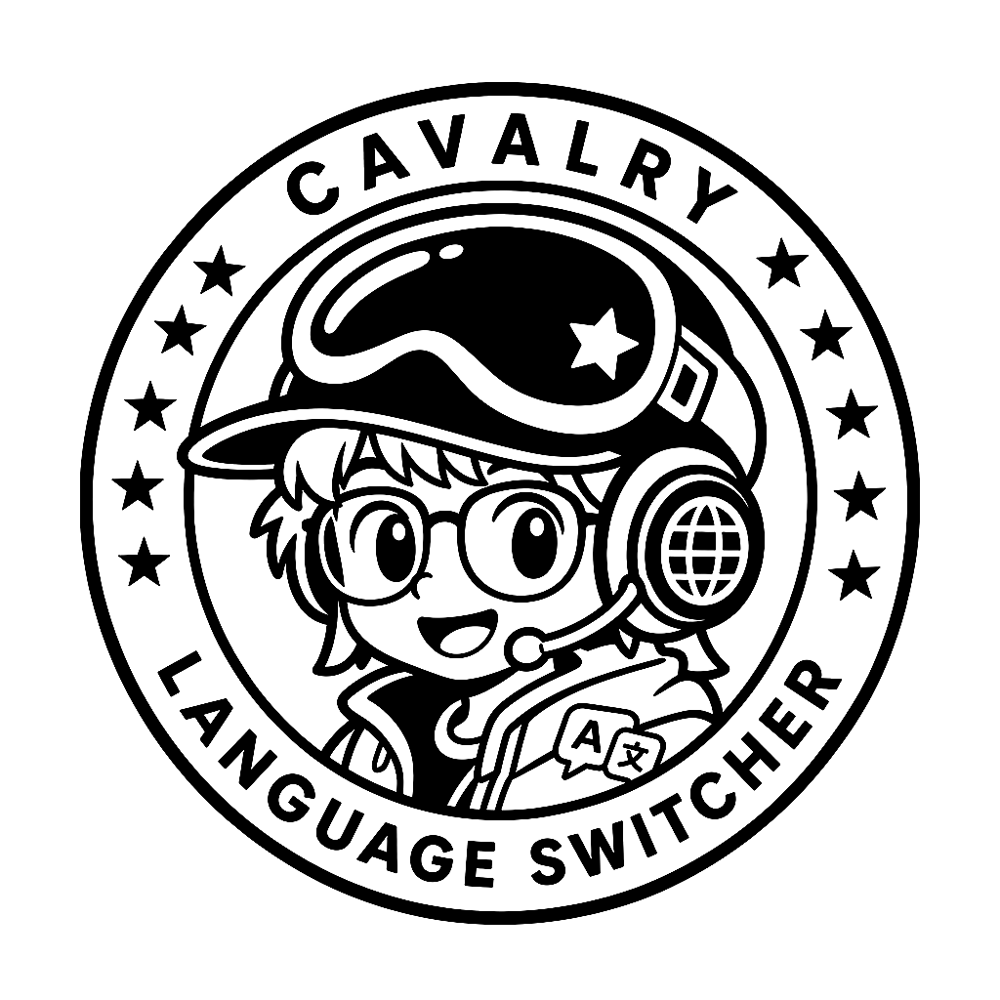
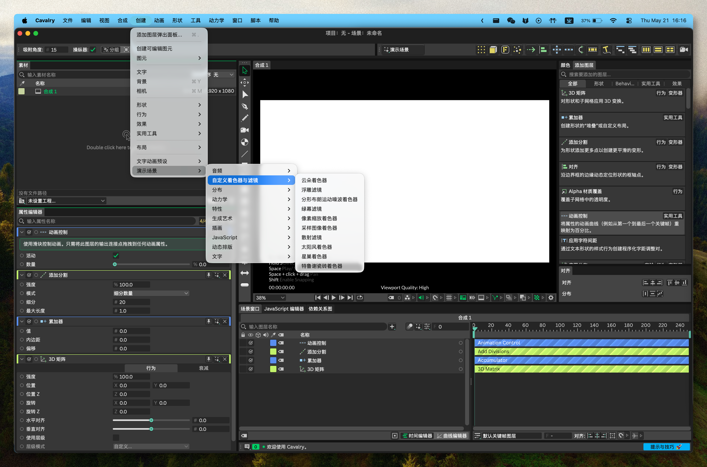

<!--
[INPUT]: 依赖 GitHub 最新正式 Release、当前发布配置、平台运行时边界与 LOCAL_BUILD_SOP
[OUTPUT]: 对外提供预览、2.8.1 亮点、使用与恢复、Release 安装说明及折叠的开发和翻译资料
[POS]: 仓库英文入口；默认 README 使用简体中文，本页与其他语言同步发布事实
[PROTOCOL]: 变更时更新此头部，然后检查 CLAUDE.md
-->

<div align="center">
  
  <h1>Cavalry-i18n</h1>
  <p>Switch <a href="https://cavalry.scenegroup.co/">Cavalry</a> 2.8.1 between English, Simplified Chinese, Traditional Chinese, and Japanese on macOS and Windows.</p>
  <a href="https://github.com/daftAI2026/Cavalry-i18n/stargazers"></a>
  <a href="https://github.com/daftAI2026/Cavalry-i18n/releases/latest"></a>
  <a href="LICENSE"></a>

  <p>Languages: <a href="README.md">简体中文</a> | English | <a href="README.zh-Hant.md">繁體中文</a> | <a href="README.ja_JP.md">日本語</a></p>
</div>

## Preview



Simplified Chinese on Cavalry 2.8.0: three-level menus, the Attribute Editor, layer names, and the Add Layers panel.

## What’s New in 2.8.1

- Menu, node, attribute, plugin-help, and built-in guide translations adapted for Cavalry 2.8.1.
- Translated official demo menus, composition names, and author-named layers without rewriting existing user projects.
- Improved Chinese and Japanese font rendering in the Time Editor, viewport, and tooltips, plus fixes for Japanese Quick Add queries.
- Faster language switching after the patch is installed, with progress that includes configuration-recovery checks.

See [all p1 changes](https://github.com/daftAI2026/Cavalry-i18n/releases/tag/cavalry-2.8.1-p1).

## Quick Start

1. Save your work and quit Cavalry.
2. Open Cavalry Language Switcher, check the detected Cavalry 2.8.1 path, or select your installation manually.
3. Choose a language and select **Switch**. Cavalry opens automatically when the change is complete.

The Switcher notifies you when an app update is available. If the current language has an update badge, select it and choose **Update** to refresh its language resources and required runtime without restoring English first. The current language is unavailable for re-selection only when it is up to date. Progress appears below the buttons.

**Restore English** restores the saved profile strings, sets the locale to English, and reverses Switcher-owned runtime changes. If profile files changed after the Switcher wrote them, restoration stops and preserves those changes. It does not reinstall Cavalry; if a required runtime baseline is missing or invalid, the bundle write stops.

## Permissions & Recovery

Cavalry Language Switcher is an independent community tool. It is not made by, endorsed by, or affiliated with Scene Group, Cavalry, or Canva.

The Switcher modifies the local Cavalry installation. If the version is unsupported, the installation cannot be verified, or a write is denied, the new language is not applied.

On macOS, it tries the change directly and opens **System Settings → Privacy & Security → App Management** only after macOS actually denies the write. Grant access only if you trust the build; macOS may ask you to reopen the Switcher before trying again. A changed `Cavalry.app` is locally re-signed so it can launch.

On Windows, writable custom locations are handled directly. UAC elevation is limited to Cavalry installations under the system Program Files directories. Unknown DLLs are never deleted or replaced.

## Install From Release

Download from [GitHub Releases](https://github.com/daftAI2026/Cavalry-i18n/releases/latest): macOS DMG (Apple Silicon or Intel), or the Windows x64 NSIS installer.

For Cavalry 2.7.2, use the historical [p12 release](https://github.com/daftAI2026/Cavalry-i18n/releases/tag/cavalry-2.7.2-p12).

On macOS, open the DMG and drag the app into Applications. On Windows, run the installer.

<details>
<summary>macOS first launch is blocked?</summary>

The macOS build is ad-hoc signed and not Apple-notarized. If macOS blocks the first launch after installation, run:

```bash
xattr -dr com.apple.quarantine "/Applications/Cavalry Language Switcher.app"
codesign --force --deep --sign - "/Applications/Cavalry Language Switcher.app"
open "/Applications/Cavalry Language Switcher.app"
```

An app update installs a new app bundle, so macOS may require the same steps again.

</details>

The Windows installer is not Authenticode-signed and may show an unknown-publisher warning; confirm that it came from this project's GitHub Release.

## Development & Contributing

For source builds, use the pinned toolchain and platform prerequisites in [LOCAL_BUILD_SOP.md](LOCAL_BUILD_SOP.md) before running these commands.

```bash
npm install
npm run tauri:dev              # Run from source
npm run build:tauri            # Build macOS DMG
npm run build:tauri:windows    # Build Windows NSIS on Windows
```

```bash
npm run test:contracts         # Renderer, bridge, release, and packaging contracts
npm run test:tauri             # Rust tests
npm run check:app              # JavaScript syntax
```

2.8.1 production builds target Qt 6.9.2. Do not build release packages from floating dependencies; use [LOCAL_BUILD_SOP.md](LOCAL_BUILD_SOP.md).

### AI / Agent Guide

Before changing code, read [AGENTS.md](AGENTS.md), [CLAUDE.md](CLAUDE.md), and the nearest module-level `CLAUDE.md`. These files define the architecture map, ownership boundaries, commands, and documentation protocol.

<details>
<summary>Implementation, translation sources, repository layout, and CI</summary>

### How It Works

The Cavalry 2.8.1 language pack writes native UI text and the locale setting to the current user's Cavalry profile. It does not use the historical 2.7 JSON asset overlays. On macOS, a native runtime change requires a verified Cavalry target and an official baseline before bundle writes. If the baseline is missing or invalid, the runtime operation stops before writing.

1. Verify the selected Cavalry 2.8.1 installation and embedded native-resource manifest.
2. Load the approved language pack built from the pinned Cavalry 2.8.1 catalogs.
3. Apply the locale and `strings.json` pack to the current user's Cavalry profile.
4. Use the platform's verified native-runtime transaction when a runtime change is required.
5. Open Cavalry after the language transaction commits.

### Supported Languages

| Language | Code |
|----------|------|
| English | `en` |
| 简体中文 | `zh-Hans` |
| 繁體中文 | `zh-Hant` |
| 日本語 | `ja_JP` |

### Translation Surfaces

For Cavalry 2.8.1, native user-profile packs use source-bound approvals in `languages/native/` and official catalogs pinned in `tools/cavalry_native_target.json`. `tools/native_resource_bundle.js` validates and builds the three target-language packs. Do not edit generated packs by hand.

The builder preserves official `dontTranslate` rows by default. Its display exception covers only 100 approved built-in demo menu labels with exact catalog identities and values. It does not change preset paths, model names, menu actions, or user-entered text.

The `languages/` JSON overlays and `tools/*.ts` injector translations are separate legacy/runtime surfaces, not the Cavalry 2.8.1 native user-profile pack source. The generated injector table must not be edited by hand. Translation rules and live verification are documented in [docs/translation-guidelines.md](docs/translation-guidelines.md) and [docs/runtime-ui-live-capture-workflow.md](docs/runtime-ui-live-capture-workflow.md).

### Repository

```text
Cavalry-i18n/
├── renderer/          # Tauri WebView UI
├── src-tauri/         # Rust commands and platform transactions
├── injector/          # macOS and Windows Qt runtime translators
├── languages/         # Legacy JSON packs and approved 2.8.1 native translations
├── tools/             # Build, validation, and release tooling
├── docs/              # Public rules, repeatable SOPs, and images
└── .github/workflows/ # CI, platform packaging, and Release publication
```

### CI/CD

| Job | Purpose |
| --- | --- |
| `build` | Syntax, contracts, and translation validation |
| `windows_check` | Windows translator, Rust, NSIS lifecycle, and updater package |
| `package_macos` | Apple Silicon and Intel Tauri packages with packaged checks |
| `release` | Signed updater manifest plus seven exact-readback public assets for `cavalry-*-p*` tags |

</details>

## Support

- If Cavalry-i18n helped you, [share it](https://twitter.com/intent/tweet?url=https://github.com/daftAI2026/Cavalry-i18n&text=Cavalry-i18n%20-%20Switch%20Cavalry%E2%80%99s%20UI%20between%20English,%20Chinese,%20and%20Japanese%20with%20one%20click.) with friends or give it a star.
- Found a bug? Use the [bug report form](https://github.com/daftAI2026/Cavalry-i18n/issues/new?template=bug_report.yml). For ideas or code contributions, open an issue or PR.

## License

MIT License. Feel free to use Cavalry-i18n and contribute.
