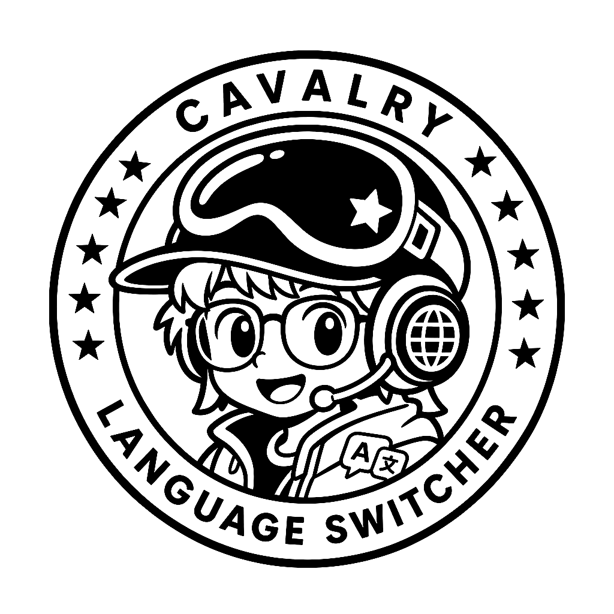
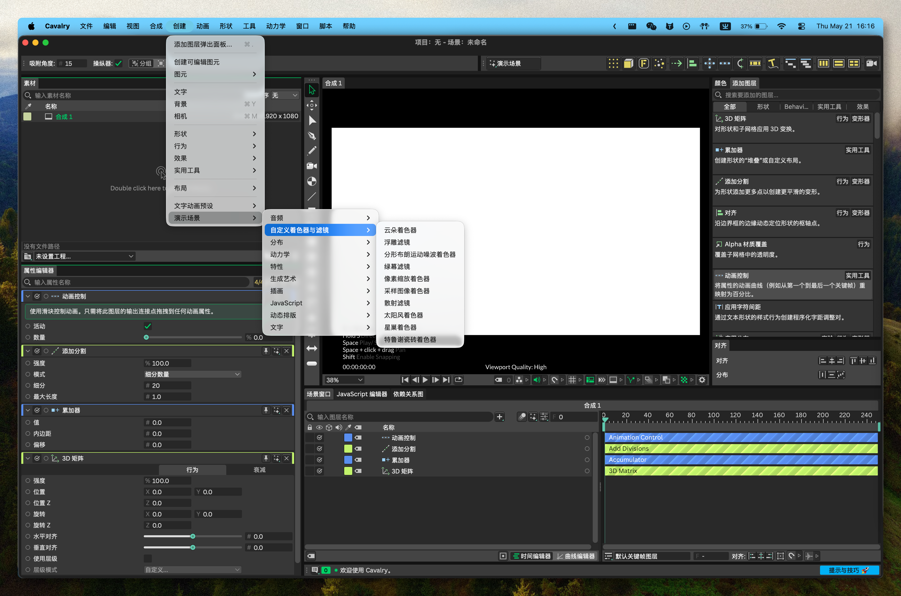

<!--
[INPUT]: 依赖 GitHub 最新正式 Release、当前发布配置、平台运行时边界与 LOCAL_BUILD_SOP
[OUTPUT]: 提供预览、2.8.1 亮点、使用与恢复、Release 安装说明及折叠的开发和翻译资料
[POS]: 仓库默认中文主入口；清楚说明 Cavalry 汉化、中文语言包与平台支持，与其他语言同步发布事实
[PROTOCOL]: 变更时更新此头部，然后检查 CLAUDE.md
-->

<div align="center">
  
  <h1>Cavalry-i18n · Cavalry 汉化工具</h1>
  <p><a href="https://cavalry.scenegroup.co/">Cavalry</a> 2.8.1 中文语言包与汉化工具，支持 Windows 和 macOS，可切换简体中文、繁體中文、日本語和 English。</p>
  <a href="https://github.com/daftAI2026/Cavalry-i18n/stargazers"></a>
  <a href="https://github.com/daftAI2026/Cavalry-i18n/releases/latest"></a>
  <a href="LICENSE"></a>

  <p>语言：简体中文 | <a href="README.en.md">English</a> | <a href="README.zh-Hant.md">繁體中文</a> | <a href="README.ja_JP.md">日本語</a></p>
</div>

## 预览



Cavalry 2.8.0 实机截图，展示三级菜单、属性编辑器、图层名称与添加图层面板。

## 2.8.1 版本亮点

- 适配 Cavalry 2.8.1 的菜单、节点、属性、插件说明及内置指南译文。
- 翻译官方示例菜单、合成名和作者命名图层，不改写已有用户工程。
- 改善时间编辑器、视口和工具提示中的中文、日文字体显示，并修复部分日文快速添加查询。
- 优化已应用补丁后的语言切换速度，进度中补充配置恢复检查。

[查看 p1 完整更新内容](https://github.com/daftAI2026/Cavalry-i18n/releases/tag/cavalry-2.8.1-p1)。

## 使用

1. 保存工作并退出 Cavalry。
2. 打开 Cavalry Language Switcher，确认自动检测到的 Cavalry 2.8.1 路径；也可以手动选择安装位置。
3. 选择语言，点击 **“切换”**；完成后 Cavalry 会自动打开。

切换器会提醒可用的应用更新。当前语言出现更新徽章时，选择它并点击 **“更新”**，即可更新语言资源及所需运行时，无须先恢复英文；只有资源已是最新时，当前语言才不可重复选择。操作进度显示在按钮下方。

**“恢复英文”** 会恢复已保存的用户配置文本、将语言设为英文，并还原切换器拥有的运行时修改。若用户在切换后改动了配置，恢复会停止并保留这些修改。它不会重新安装 Cavalry；若所需运行时基线缺失或无效，对应的应用包写入会停止。

## 权限与恢复

Cavalry Language Switcher 是独立社区工具，不隶属于 Scene Group、Cavalry 或 Canva。

语言切换器会修改本机 Cavalry 安装。如果版本不受支持、无法验证安装或写入被拒绝，新语言不会生效。

在 macOS 上，它会先直接尝试切换。只有系统真实拒绝写入后，才会打开 **“系统设置 → 隐私与安全性 → App Management”**。仅在信任当前构建时授权；macOS 可能要求重新打开语言切换器后再试。修改后的 `Cavalry.app` 会在本地重新签名，以便正常启动。

在 Windows 上，当前用户可写的自定义目录会直接处理。UAC 提权仅用于系统 Program Files 目录中的 Cavalry 安装。未知 DLL 不会被删除或替换。

## 从 Release 安装

从 [GitHub Releases](https://github.com/daftAI2026/Cavalry-i18n/releases/latest) 下载：macOS DMG（Apple Silicon 或 Intel）或 Windows x64 NSIS 安装程序。

Cavalry 2.7.2 用户请使用历史版本 [p12 Release](https://github.com/daftAI2026/Cavalry-i18n/releases/tag/cavalry-2.7.2-p12)。

macOS：打开 DMG，将应用拖入“应用程序”。Windows：运行安装程序。

<details>
<summary>macOS 首次打开受阻？</summary>

macOS 版本使用 ad-hoc 签名，尚未经过 Apple 公证。安装后若 macOS 阻止首次打开，请运行：

```bash
xattr -dr com.apple.quarantine "/Applications/Cavalry Language Switcher.app"
codesign --force --deep --sign - "/Applications/Cavalry Language Switcher.app"
open "/Applications/Cavalry Language Switcher.app"
```

应用内更新会安装新的 app bundle，因此 macOS 可能要求再次执行这些步骤。

</details>

Windows 安装器尚未进行 Authenticode 签名，可能显示“未知发布者”；请确认文件来自本项目的 GitHub Release。

## 开发与贡献

源码构建前，请按 [LOCAL_BUILD_SOP.md](LOCAL_BUILD_SOP.md) 准备固定工具链和平台依赖，再运行以下命令。

```bash
npm install
npm run tauri:dev              # 从源码运行
npm run build:tauri            # 构建 macOS DMG
npm run build:tauri:windows    # 在 Windows 上构建 NSIS
```

```bash
npm run test:contracts         # Renderer、bridge、发布与打包合同
npm run test:tauri             # Rust 测试
npm run check:app              # JavaScript 语法
```

2.8.1 生产构建使用 Qt 6.9.2。发布包不得依赖浮动工具版本；请遵循 [LOCAL_BUILD_SOP.md](LOCAL_BUILD_SOP.md)。

### AI / Agent Guide

修改代码前，请阅读 [AGENTS.md](AGENTS.md)、[CLAUDE.md](CLAUDE.md) 和目标模块最近的 `CLAUDE.md`。这些文件定义架构地图、职责边界、命令和文档协议。

<details>
<summary>工作原理、翻译来源、仓库结构与 CI</summary>

### 工作原理

2.8.1 语言包会将原生界面文本和语言设置写入当前用户的 Cavalry 配置。它不使用历史 2.7 JSON 资源覆盖。macOS 需要变更原生运行时时，会先验证 Cavalry 目标和官方基线。基线缺失或无效时，运行时写入会停止。

1. 验证所选 Cavalry 2.8.1 安装和内嵌原生资源清单。
2. 加载由固定 Cavalry 2.8.1 目录构建的已批准语言包。
3. 将语言设置和 `strings.json` 包写入当前用户的 Cavalry 配置。
4. 需要变更运行时时，调用经过验证的平台原生运行时事务。
5. 语言事务提交后打开 Cavalry。

### 支持语言

| 语言 | 代码 |
|----------|------|
| English | `en` |
| 简体中文 | `zh-Hans` |
| 繁體中文 | `zh-Hant` |
| 日本語 | `ja_JP` |

### 翻译面

2.8.1 原生用户配置包使用 `languages/native/` 中绑定原文的批准译文，并读取固定在 `tools/cavalry_native_target.json` 的官方目录。`tools/native_resource_bundle.js` 会校验并构建三种目标语言包。不要手动修改生成包。

构建器默认保留官方 `dontTranslate` 条目。显示例外只覆盖 100 个身份和译值均已核对的内置示例菜单标签。它不会修改预设路径、模型名称、菜单动作或用户输入文本。

`languages/` 中的 JSON 覆盖包和 `tools/*.ts` 注入器译文属于独立的历史或运行时路径，不是 Cavalry 2.8.1 原生用户配置包的来源。生成的注入器表也不得手动修改。翻译规则和实机验证流程见 [docs/translation-guidelines.md](docs/translation-guidelines.md) 与 [docs/runtime-ui-live-capture-workflow.md](docs/runtime-ui-live-capture-workflow.md)。

### 仓库结构

```text
Cavalry-i18n/
├── renderer/          # Tauri WebView 界面
├── src-tauri/         # Rust 命令与平台事务
├── injector/          # macOS 与 Windows Qt 运行时翻译器
├── languages/         # 历史 JSON 包与 2.8.1 原生批准译文
├── tools/             # 构建、验证与发布工具
├── docs/              # 公开规则、可重复 SOP 与图片
└── .github/workflows/ # CI、平台打包与 Release 发布
```

### CI/CD

| Job | 职责 |
| --- | --- |
| `build` | 语法、合同与翻译验证 |
| `windows_check` | Windows 翻译器、Rust、NSIS 生命周期与更新包 |
| `package_macos` | Apple Silicon 与 Intel Tauri 打包及产物检查 |
| `release` | 为 `cavalry-*-p*` tag 发布签名更新清单与七项精确回读资产 |

</details>

## 支持

- 如果 Cavalry-i18n 帮到了你，可以把它[分享](https://twitter.com/intent/tweet?url=https://github.com/daftAI2026/Cavalry-i18n&text=Cavalry-i18n%20-%20Switch%20Cavalry%E2%80%99s%20UI%20between%20English,%20Chinese,%20and%20Japanese%20with%20one%20click.)给朋友，或点一个 star。
- 遇到 bug？请使用[问题反馈模板](https://github.com/daftAI2026/Cavalry-i18n/issues/new?template=bug_report.yml)。想法或代码贡献也欢迎提交 Issue 或 PR。

## 许可证

MIT License。欢迎使用 Cavalry-i18n 并参与贡献。
