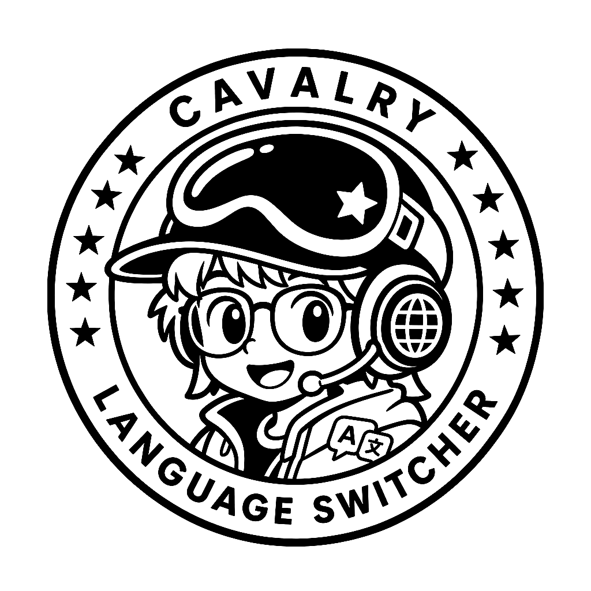
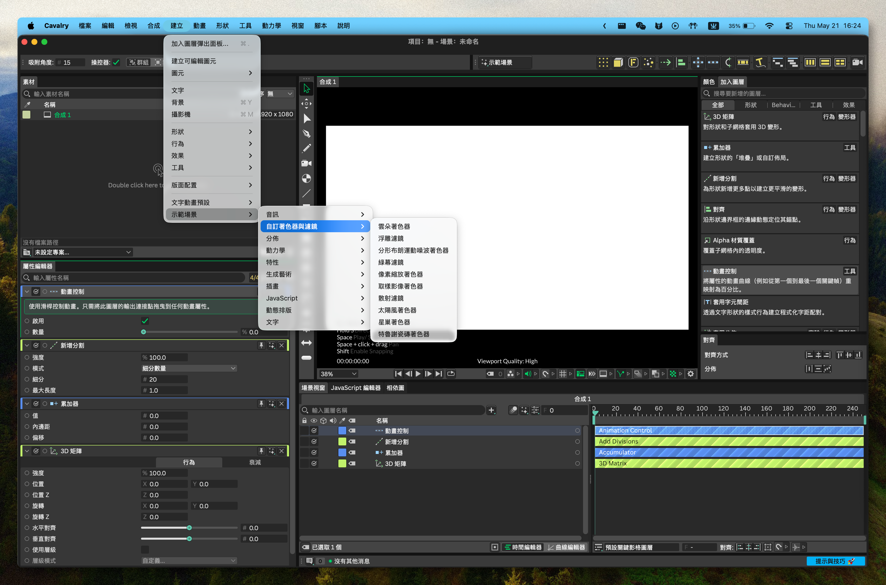

<!--
[INPUT]: 依赖 GitHub 最新正式 Release、当前发布配置、平台运行时边界与 LOCAL_BUILD_SOP
[OUTPUT]: 提供預覽、2.8.1重點、使用與還原、Release安裝說明及摺疊的開發和翻譯資料
[POS]: 倉庫繁體中文使用者入口；與英文及其他本地化 README 同步發布真相，不替代平台真機驗收
[PROTOCOL]: 变更时更新此头部，然后检查 CLAUDE.md
-->

<div align="center">
  
  <h1>Cavalry-i18n</h1>
  <p>在 macOS 和 Windows 上，將 <a href="https://cavalry.scenegroup.co/">Cavalry</a> 2.8.1 切換為英文、簡體中文、繁體中文或日本語。</p>
  <a href="https://github.com/daftAI2026/Cavalry-i18n/stargazers"></a>
  <a href="https://github.com/daftAI2026/Cavalry-i18n/releases/latest"></a>
  <a href="LICENSE"></a>

  <p>Languages: <a href="README.md">简体中文</a> | <a href="README.en.md">English</a> | 繁體中文 | <a href="README.ja_JP.md">日本語</a></p>
</div>

## 預覽



Cavalry 2.8.0 實機截圖，展示三級選單、屬性編輯器、圖層名稱與加入圖層面板。

## 2.8.1 版本重點

- 適配 Cavalry 2.8.1 的選單、節點、屬性、外掛說明及內建指南譯文。
- 翻譯官方示例選單、合成名稱及作者命名的圖層，不改寫既有使用者專案。
- 改善時間編輯器、檢視區及工具提示中的中文、日文字型顯示，並修正部分日文快速新增查詢。
- 加快套用修補程式後的語言切換，並在進度中補上設定還原檢查。

[查看 p1 完整更新內容](https://github.com/daftAI2026/Cavalry-i18n/releases/tag/cavalry-2.8.1-p1)。

## 使用方式

1. 儲存工作並結束 Cavalry。
2. 開啟 Cavalry Language Switcher，確認自動偵測到的 Cavalry 2.8.1 路徑；也可以手動選擇安裝位置。
3. 選擇語言並點選 **「切換」**；完成後 Cavalry 會自動開啟。

切換器會通知可用的應用程式更新。目前語言出現更新標記時，選取它並點選 **「更新」**，即可更新語言資源及所需執行階段，不必先還原英文；只有資源已是最新時，目前語言才無法重複選取。操作進度顯示在按鈕下方。

**「還原英文」** 會還原已儲存的使用者設定文字、將語言設為英文，並復原切換器擁有的執行階段修改。若使用者在切換後變更設定，還原會停止並保留這些變更。此功能不會重新安裝 Cavalry；若所需執行階段基線缺失或無效，對應的應用程式套件寫入會停止。

## 權限與還原

Cavalry Language Switcher 是獨立社群工具，不隸屬於 Scene Group、Cavalry 或 Canva。

語言切換器會修改本機 Cavalry 安裝。如果版本不受支援、無法驗證安裝或寫入遭拒，新語言不會生效。

在 macOS 上，它會先直接嘗試切換。只有系統實際拒絕寫入後，才會開啟 **「系統設定 → 隱私權與安全性 → App Management」**。僅在信任目前構建時授權；macOS 可能要求重新開啟語言切換器後再試。修改後的 `Cavalry.app` 會在本機重新簽名，以便正常啟動。

在 Windows 上，目前使用者可寫入的自訂目錄會直接處理。UAC 提權僅用於系統 Program Files 目錄中的 Cavalry 安裝。不明 DLL 不會被刪除或替換。

## 從 Release 安裝

從 [GitHub Releases](https://github.com/daftAI2026/Cavalry-i18n/releases/latest) 下載：macOS DMG（Apple Silicon 或 Intel）或 Windows x64 NSIS 安裝程式。

Cavalry 2.7.2 使用者請使用歷史版本 [p12 Release](https://github.com/daftAI2026/Cavalry-i18n/releases/tag/cavalry-2.7.2-p12)。

macOS：開啟 DMG，將應用程式拖入「應用程式」。Windows：執行安裝程式。

<details>
<summary>macOS 首次開啟受阻？</summary>

macOS 版本使用 ad-hoc 簽名，尚未經過 Apple 公證。安裝後若 macOS 阻止首次開啟，請執行：

```bash
xattr -dr com.apple.quarantine "/Applications/Cavalry Language Switcher.app"
codesign --force --deep --sign - "/Applications/Cavalry Language Switcher.app"
open "/Applications/Cavalry Language Switcher.app"
```

應用程式內更新會安裝新的 app bundle，因此 macOS 可能要求再次執行這些步驟。

</details>

Windows 安裝程式尚未進行 Authenticode 簽名，可能顯示「未知發行者」；請確認檔案來自本專案的 GitHub Release。

## 開發與貢獻

從原始碼建置前，請依 [LOCAL_BUILD_SOP.md](LOCAL_BUILD_SOP.md) 準備固定工具鏈及平台相依項目，再執行以下命令。

```bash
npm install
npm run tauri:dev              # 從原始碼執行
npm run build:tauri            # 構建 macOS DMG
npm run build:tauri:windows    # 在 Windows 上構建 NSIS
```

```bash
npm run test:contracts         # Renderer、bridge、發布與打包合同
npm run test:tauri             # Rust 測試
npm run check:app              # JavaScript 語法
```

2.8.1 生產建置使用 Qt 6.9.2。發布套件不得依賴浮動工具版本；請遵循 [LOCAL_BUILD_SOP.md](LOCAL_BUILD_SOP.md)。

### AI / Agent Guide

修改程式碼前，請閱讀 [AGENTS.md](AGENTS.md)、[CLAUDE.md](CLAUDE.md) 和目標模組最近的 `CLAUDE.md`。這些檔案定義架構地圖、職責邊界、命令和文件協定。

<details>
<summary>工作原理、翻譯來源、儲存庫結構與 CI</summary>

### 工作原理

2.8.1 語言包會將原生介面文字和語言設定寫入目前使用者的 Cavalry 設定。它不使用歷史 2.7 JSON 資源覆蓋。macOS 需要變更原生執行階段時，會先驗證 Cavalry 目標和官方基線。基線缺失或無效時，執行階段寫入會停止。

1. 驗證所選 Cavalry 2.8.1 安裝和內嵌原生資源清單。
2. 載入由固定 Cavalry 2.8.1 目錄建置的已核准語言包。
3. 將語言設定和 `strings.json` 包寫入目前使用者的 Cavalry 設定。
4. 需要變更執行階段時，呼叫經驗證的平台原生執行階段交易。
5. 語言交易提交後開啟 Cavalry。

### 支援語言

| 語言 | 代碼 |
|----------|------|
| English | `en` |
| 簡體中文 | `zh-Hans` |
| 繁體中文 | `zh-Hant` |
| 日本語 | `ja_JP` |

### 翻譯面

2.8.1 原生使用者設定包使用 `languages/native/` 中綁定原文的核准譯文，並讀取固定於 `tools/cavalry_native_target.json` 的官方目錄。`tools/native_resource_bundle.js` 會驗證並建置三種目標語言包。請勿手動修改生成包。

建置器預設保留官方 `dontTranslate` 項目。顯示例外只涵蓋 100 個身分與譯值均已核對的內建示例選單標籤。它不會修改預設集路徑、模型名稱、選單動作或使用者輸入文字。

`languages/` 中的 JSON 覆蓋包和 `tools/*.ts` 注入器譯文屬於獨立的歷史或執行階段路徑，不是 Cavalry 2.8.1 原生使用者設定包的來源。生成的注入器表也不得手動修改。翻譯規則和實機驗證流程見 [docs/translation-guidelines.md](docs/translation-guidelines.md) 與 [docs/runtime-ui-live-capture-workflow.md](docs/runtime-ui-live-capture-workflow.md)。

### 倉庫結構

```text
Cavalry-i18n/
├── renderer/          # Tauri WebView 介面
├── src-tauri/         # Rust 命令與平台作業
├── injector/          # macOS 與 Windows Qt 執行階段翻譯器
├── languages/         # 歷史 JSON 包與 2.8.1 原生核准譯文
├── tools/             # 構建、驗證與發布工具
├── docs/              # 公開規則、可重複 SOP 與圖片
└── .github/workflows/ # CI、平台打包與 Release 發布
```

### CI/CD

| Job | 職責 |
| --- | --- |
| `build` | 語法、合同與翻譯驗證 |
| `windows_check` | Windows 翻譯器、Rust、NSIS 生命週期與更新包 |
| `package_macos` | Apple Silicon 與 Intel Tauri 打包及產物檢查 |
| `release` | 為 `cavalry-*-p*` tag 發布簽名更新清單與七項精確回讀資產 |

</details>

## 支援

- 如果 Cavalry-i18n 幫到了你，可以把它[分享](https://twitter.com/intent/tweet?url=https://github.com/daftAI2026/Cavalry-i18n&text=Cavalry-i18n%20-%20Switch%20Cavalry%E2%80%99s%20UI%20between%20English,%20Chinese,%20and%20Japanese%20with%20one%20click.)給朋友，或點一個 star。
- 遇到 bug？請使用[問題回報範本](https://github.com/daftAI2026/Cavalry-i18n/issues/new?template=bug_report.yml)。想法或程式碼貢獻也歡迎提交 Issue 或 PR。

## 授權

MIT License。歡迎使用 Cavalry-i18n 並參與貢獻。
